

  

  
  
  

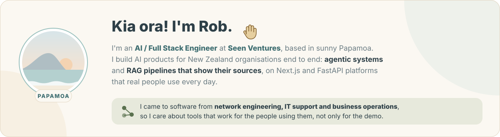

  

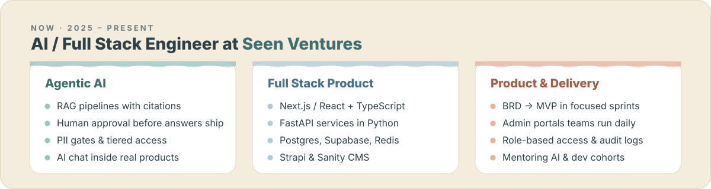

 

  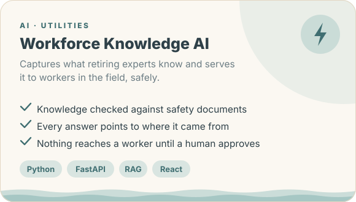
  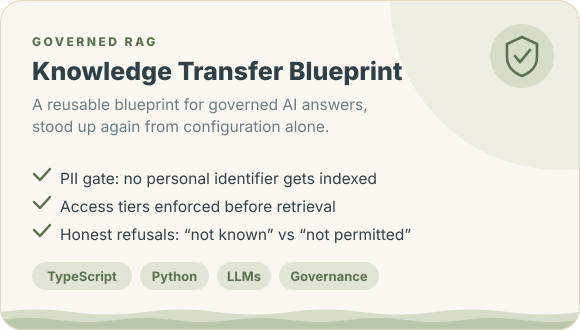

  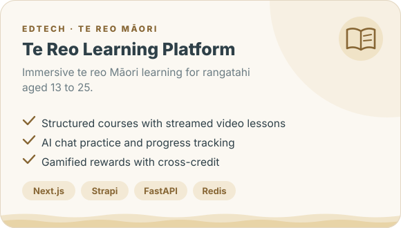
  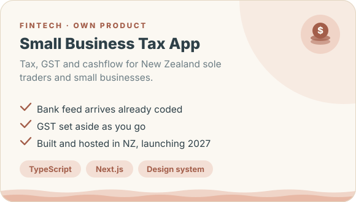

  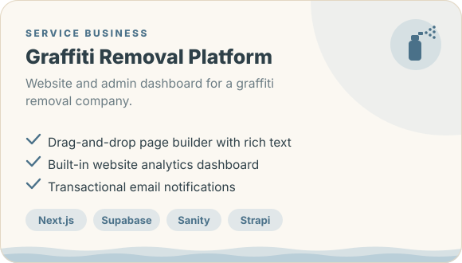
  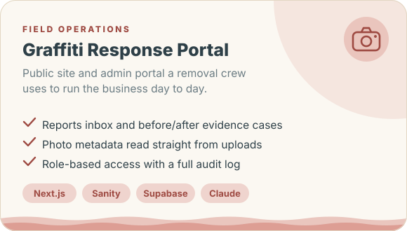

  

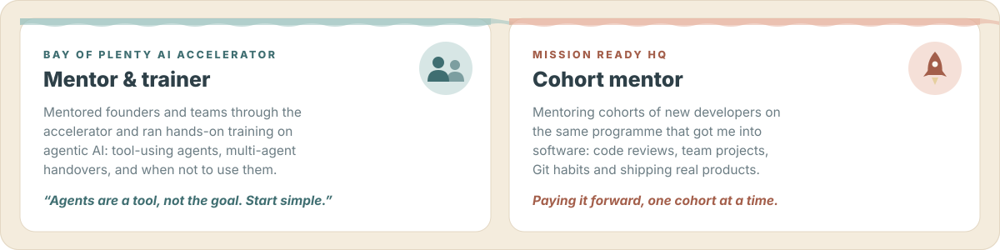

  

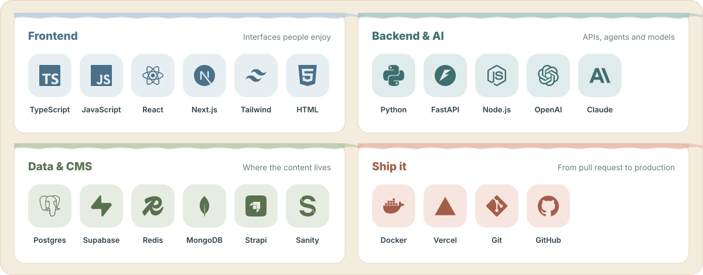

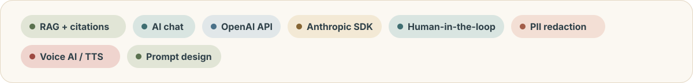

 


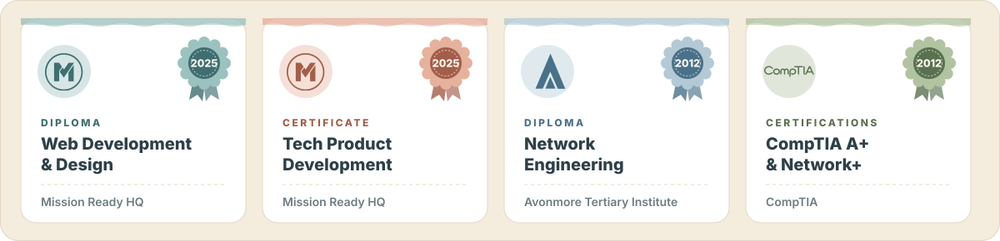

 

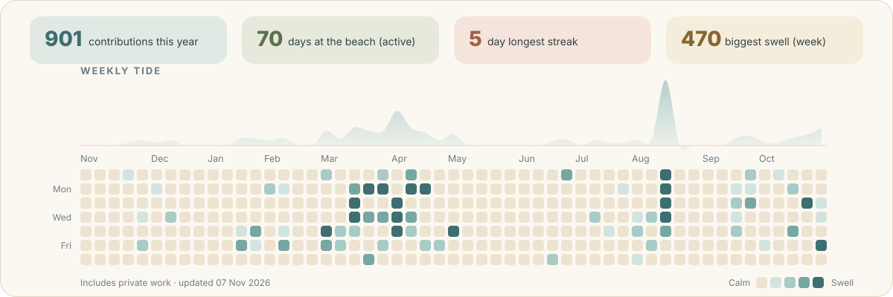

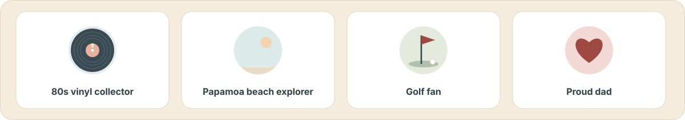

 


  
  <a href="https://linkedin.com/in/rob-wynyard-567231358z">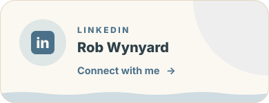</a>
  

Always up for a kōrero about agentic AI, governed RAG, or turning a messy problem into a product people actually use.

